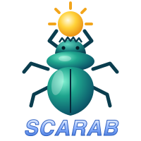

# Scarab

<div align="center">


[](https://github.com/popolony2k/scarab/actions/workflows/ci.yml)
[](https://github.com/popolony2k/scarab/releases/latest)
[](https://github.com/popolony2k/scarab/blob/main/LICENSE)

`Scarab` is an open source host for 2D games written entirely in Lua. It owns the window, the render loop and resource loading, and gives the game a Lua API for maps, sprites, collisions, input, sound and text; the game itself - every enemy, the player, its stages - is Lua, with no C++ to write.

It is built on [sunlight](https://github.com/popolony2k/sunlight), the C++17 library for 2D games from [Tiled](https://www.mapeditor.org/) maps.
</div>

## Table of Contents :pushpin:
* [Lua API reference](https://popolony2k.github.io/scarab/lua-api/) :book:
* [C++ reference](https://popolony2k.github.io/scarab/) :gear:
* [License](https://github.com/popolony2k/scarab/blob/main/LICENSE) (zlib) :page_facing_up:
* [Motivation](#motivation-bulb)
* [Features](#features-sparkles)
* [Requirements](#requirements-memo)
* [HowTo](#howto-hammer)
    - [Building](#building)
    - [Running a game](#running-a-game)
    - [Headless mode](#headless-mode)
    - [Running tests](#running-tests)
    - [Content encryption](#content-encryption)
    - [Configuring VSCode](#configuring-vscode)
* [Samples](#samples-video_game)
* [Shared resources](#shared-resources-art)

## Motivation :bulb:

Scarab started as a personal project with a simple goal: build a game called **Caravellius**. Months into that game's own development, the parts that had nothing to do with any specific game — the window/render loop, tile-map rendering, sprites, collision, sound, input — were split out into their own library, [**sunlight**](https://github.com/popolony2k/sunlight). About a year later, a second idea became clear: that same game-agnostic split could go one step further, into a thin host with *no* game-specific C++ left at all, where an entire game is scripted in Lua on top of sunlight instead. That idea became Scarab, split out by its author into a project of its own.

Read the full story, in the author's own words: [*From a Transforming Ship to a Transforming Engine*](https://www.popolony2k.com.br/from-a-transforming-ship-to-a-transforming-engine/). The Scarab side of that story is its own article: [*The Beetle That Carried the Light*](https://www.popolony2k.com.br/the-beetle-that-carried-the-light/).

## Features :sparkles:

* **Games in Lua only:** one `scarab` executable runs any game; which one is chosen at launch by a `project.json`, a `.lua` script or a single `.zip` bundle.
* **Renderer and views:** create the window with your own settings (size, zoom, viewport, FPS, fullscreen), and show one world in several views at once - a minimap, a close-up.
* **Tiled maps:** tile, image, group and object layers, tile animation, tile/text/shape/point objects with rotation and opacity, layer opacity and tint at runtime, external tilesets.
* **Sprites:** pooled, animated sprites on map layers or with no map at all, in screen or map (world) space, with opacity, tint and blend modes.
* **Collisions:** sprite-to-sprite and sprite-to-tile rules with a Lua handler.
* **Input:** keyboard and gamepads.
* **Sound and sequencing:** sound effects and songs, timers, and a queued command processor for stage intros and waves.
* **Text:** TrueType/OpenType and BMFont fonts by handle, measured and drawn as a HUD.
* **Errors you can read:** every Lua function that can fail returns `nil, "message"`, never a crash or a silent no-op.
* **Headless runs:** a mode with no window and a virtual clock, for CI and automated playthroughs.
* **Content encryption:** pack a game into an encrypted `.zip` only your own build can open.

## Requirements :memo:

* **CMake 3.24** or later, and a **C++17 compiler** (Clang on macOS, GCC on Linux, MSVC on Windows).
* **zlib** - Ubuntu/Debian: `apt-get install zlib1g-dev`; macOS: [MacPorts](https://www.macports.org/) or [Homebrew](https://brew.sh/); Windows: see vcpkg below.
* **vcpkg (Windows only)** - `vcpkg install zlib:x64-windows libiconv:x64-windows`, with `VCPKG_ROOT` set.
* **raylib's dependencies on Linux** - on Ubuntu/Debian:
  ```shell
  apt-get install libasound2-dev libx11-dev libxrandr-dev libxi-dev libgl1-mesa-dev libglu1-mesa-dev \
                  libxcursor-dev libxinerama-dev libwayland-dev libxkbcommon-dev
  ```
  Other distributions: raylib's [wiki](https://github.com/raysan5/raylib/wiki/Working-on-GNU-Linux).

Everything else - sunlight (with raylib, libtmx, libxml2, PhysFS and SDL2), Lua, nlohmann/json, CLI11, libsodium and miniz - is fetched automatically when CMake configures.

## HowTo :hammer:

### Building

```shell
cmake -B build -S .
cmake --build build -j 4
```

On Windows, configure with `cmake --preset windows-vcpkg` instead (it points CMake at vcpkg's toolchain). For debug symbols, add `-DCMAKE_C_FLAGS="-g2" -DCMAKE_CXX_FLAGS="-g2"`. Lua is built from [walterschell/Lua](https://github.com/walterschell/Lua) by default; the `-DSCARAB_USE_OFFICIAL_LUA_FTP=ON` alternative does not work yet - see [docs/lua-integration.md](docs/lua-integration.md).

### Running a game

`scarab` needs an entry point and refuses to start without one. From the repo root, the smallest game there is:

```shell
./build/scarab samples/hello-world/project.json
```

A project file names the first Lua file to run, relative to the project file itself, so a project can move as a whole:

```json
{ "main_script": "main.lua" }
```

You can also run a script directly (`./build/scarab main.lua`) or a whole game packed into one archive (`./build/scarab game.zip`, which runs the `project.json` at its root; `--entry`/`-e <path>` names another). Loose folders and archives read the same way. `--help` lists every option, and `--version` prints the Scarab, sunlight and Lua versions.

### Headless mode

`--headless` runs a game with no window, no GPU and no display - for CI and automated runs:

```shell
./build/scarab --headless --fast --max-frames 18000 project.json
```

| Option | Meaning |
|---|---|
| `--headless` | No window (sunlight's null renderer). Input reads as nothing pressed; audio still plays if there is a device. |
| `--fast` | Don't wait for the frame rate: a 5-minute game timeline runs in seconds. Needs `--headless`. |
| `--max-frames N` | Stop after `N` frames, so a hung game fails the run instead of hanging it. Needs `--headless`. |
| `--max-frames-ok` | Reaching `--max-frames` counts as success (a plain "run N frames" check). |

The exit code is `0` when the game quits itself with `app_quit()`, `1` on a fatal error, and `3` when `--max-frames` ran out first. Time is virtual: each frame is exactly `1 / FPS`, and `app_get_time()`, `sp_wait`, animations and Lua's `os.time()`/`os.clock()` follow it; `set_timer` stays on real time.

### Running tests

Unit tests are opt-in, using [doctest](https://github.com/doctest/doctest):

```shell
cmake -B build -S . -DSCARAB_BUILD_TESTS=ON
cmake --build build -j 4
./build/scarab_tests
```

The Lua API is covered by headless smoke tests, one script each: `python3 scripts/<name>_smoke.py build/scarab`. CI runs both on Linux, macOS (arm64 and x64) and Windows, plus everything under AddressSanitizer, and a style check of [docs/CODE_STYLE.md](docs/CODE_STYLE.md).

### Content encryption

A game's folder can be packed into one `.zip` encrypted with a key compiled into your own build of `scarab`; only that build can read it. It is opt-in, and it is deterrence, not unbreakable DRM: it raises the bar past "just unzip it".

> [!WARNING]
> **AS-IS: official release binaries use a SHARED key, not a private one - for trying the feature out only.** Every official release is built with a key derived per version (the same on all platforms of that version, so a pack made with one opens on the others), which anyone can extract from the binary, and each one prints a warning saying so. It gives **no real protection**. To protect a real game, hobby or commercial, **build `scarab` yourself with your own private key** (see [tools/README.md](tools/README.md) for how to make and keep one).

```shell
python3 -c "import secrets; print(secrets.token_hex(32))"            # 1. make a key
cmake -B build -S . -DSCARAB_CONTENT_KEY=<the 64 hex characters>      #    and build with it
cmake --build build -j 4
./build/scarab --pack pack-config.json                                # 2. pack a game folder
./build/scarab my_game.zip                                            # 3. run it
```

[tools/README.md](tools/README.md) has the whole packaging workflow; the [crypto](https://popolony2k.github.io/scarab/lua-api/crypto.html) and [pack](https://popolony2k.github.io/scarab/lua-api/pack.html) reference pages cover the Lua functions behind it.

### Configuring VSCode

The repo's `.vscode` folder is local and gitignored; copy the tracked one from [docs/vscode/](docs/vscode/README.md), which also explains the per-OS settings files.

## Samples :video_game:

Each sample is a `project.json` and a Lua script, run from the repo root with nothing to compile:

```shell
./build/scarab samples/sprite/project.json
```

[samples/README.md](samples/README.md) explains how they are run and the style they follow.

### Getting started

* [hello-world](samples/hello-world/docs/README.md) — the smallest Scarab game: a window and one line of text.
* [tilemap](samples/tilemap/docs/README.md) — loads a Tiled map and reports its size; no sprites.
* [sprite](samples/sprite/docs/README.md) — builds on `tilemap` with an animated sprite you move.
* [collision](samples/collision/docs/README.md) — builds on `sprite`: walls made of map tiles, and a second sprite to bump into.

### Window, renderer and views

* [app](samples/app/docs/README.md) — window toggles: fullscreen, the FPS counter, resizing, letterbox or stretch, target FPS, a fade.
* [renderer](samples/renderer/docs/README.md) — `renderer_create` with your own settings, read back live, and the default view's zoom and camera.
* [camera](samples/camera/docs/README.md) — scrolling and zooming over a map.
* [views](samples/views/docs/README.md) — one world in three views: the main picture, a minimap and a close-up following the sprite.

### Maps, objects and drawing

* [objects](samples/objects/docs/README.md) — Tiled tile objects and text objects.
* [shapes](samples/shapes/docs/README.md) — shape and point objects, rotation, opacity, layer tint and tile animation, on five maps.
* [blend](samples/blend/docs/README.md) — blend modes on sprites and on drawn panels.
* [mapless](samples/mapless/docs/README.md) — sprites with no map loaded at all, for a title screen or a menu.

### Text and input

* [text](samples/text/docs/README.md) — fonts by handle and HUD text layout.
* [input](samples/input/docs/README.md) — keyboard and gamepad reading.

### Sequencing, timers and sound

* [scripting](samples/scripting/docs/README.md) — a repeating wave cycle built from queued `sp_*` commands.
* [timers](samples/timers/docs/README.md) — two background timers at different rates.
* [sound](samples/sound/docs/README.md) — sound effects and the three ways to play a song.

### Data and packaging

* [json](samples/json/docs/README.md) — `load_json`, a config file read into a Lua table.
* [crypto](samples/crypto/docs/README.md) — the encryption functions behind content packing, and what tampering does.

## Shared resources :art:

[resources/](resources/) holds open-source assets (fonts, sprites, maps, sounds) that the samples use and any game built on Scarab may use too; each folder's README gives its license and origin.

Scarab is licensed under the [zlib License](LICENSE); every source, script, build and config file carries the notice at its top ([docs/HEADER.txt](docs/HEADER.txt); CI checks it).
